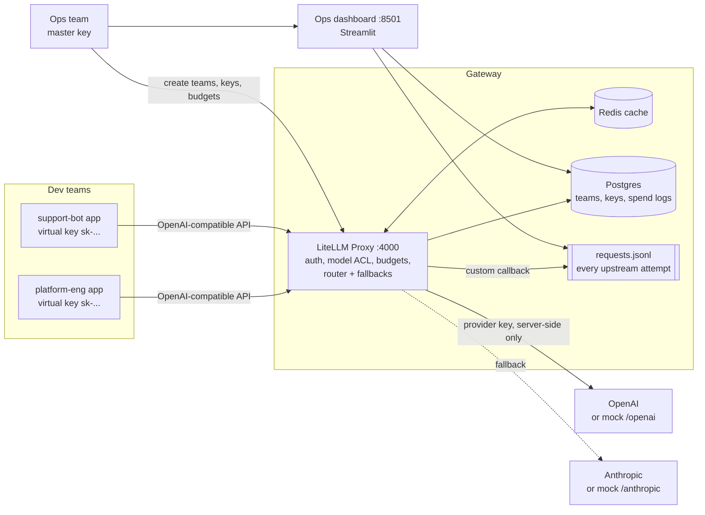
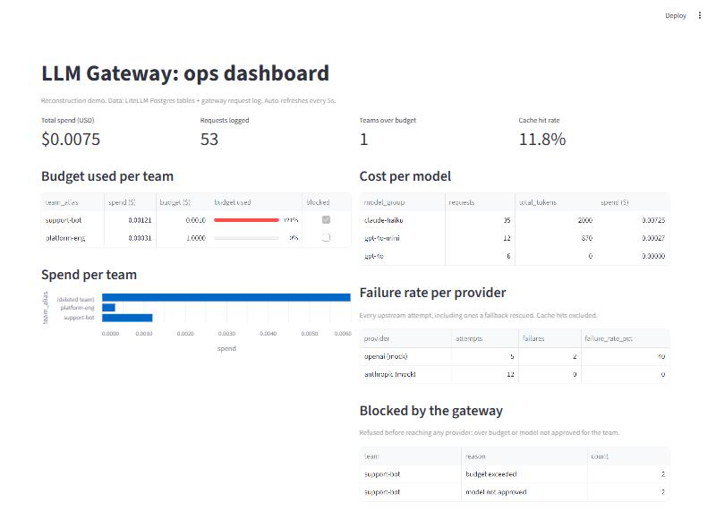
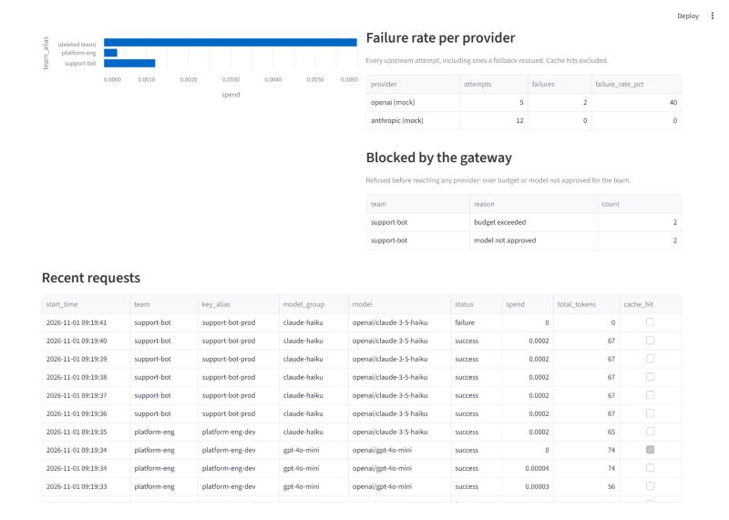

# LLM Gateway demo (LiteLLM Proxy)

A small, runnable reconstruction of an LLM gateway I built for a paying client.

> **Honest note.** This is not the client's code, and it contains none of their
> config, data or keys. The client code is private. This repo rebuilds the same
> ideas from scratch on a smaller scale, so recruiters and clients can run it and
> see how it works. Provider calls go to a local mock by default, so the whole
> demo runs offline with no paid API keys.

## What it shows

| Problem the ops team had | What the gateway does | Where |
|---|---|---|
| Raw provider keys were shared with every dev team | Ops issues one **virtual key per team**. Each key can call only that team's approved models. Devs never see provider keys. | LiteLLM teams + keys, `scripts/demo.py` step 1-2 |
| Same prompts were paid for again and again | **Response cache** (Redis in Docker, in-memory locally) | `litellm_settings.cache` |
| Nobody knew which team spent what | **Spend tracking per team, key and model**, with **hard budgets**. Requests are rejected once a team's budget is used. | LiteLLM spend tables, demo step 5 |
| No audit trail | **Request logging**: LiteLLM spend logs (metadata only by default) plus a custom callback that also records failed provider attempts | `gateway/request_logger.py` |
| One provider outage took features down | **Automatic fallback**: `gpt-4o*` falls back to `claude-haiku` | `router_settings.fallbacks`, demo step 4 |
| Ops had no single view | **Master ops dashboard**: spend per team, cost per model, budget used, failure rate per provider, recent requests and errors | `dashboard/app.py` |

## Architecture



Components:

- **`gateway/`**: LiteLLM proxy config (`config.yaml` for Docker with Redis, `config.local.yaml` for the no-Docker run with an in-memory cache) and `request_logger.py`, a LiteLLM `CustomLogger` that writes one prompt-free JSON line per upstream attempt (success or failure).
- **`mock_provider/`**: a tiny OpenAI-compatible FastAPI server that pretends to be two providers (`/openai/v1`, `/anthropic/v1`). `POST /admin/failures {"openai": true}` makes one provider return HTTP 503: that is the "force failure" switch for showing fallback.
- **`dashboard/`**: Streamlit ops dashboard. Read-only. It reads LiteLLM's own Postgres tables (`LiteLLM_TeamTable`, `LiteLLM_SpendLogs`) plus the request log. Data shaping lives in `metrics.py` and is unit tested.
- **`scripts/demo.py`**: the scripted story (teams, keys, model denial, cache, fallback, budget block).
- **`scripts/run_local.py`**: runs everything without Docker, with an embedded Postgres (`pgserver`).

LiteLLM's built-in admin UI also works at `http://localhost:4000/ui` (user `admin`, password = the master key). The custom dashboard exists because the per-provider failure view and the one-page ops summary were what the client actually wanted, and some of LiteLLM's richer spend reports are Enterprise-only.

## Run it

### Option A: Docker (proxy + Postgres + Redis + mock + dashboard)

Status: written but **not yet run end to end** (the machine this was built on has no
Docker). Option B below is the tested path.

```bash
cp .env.example .env        # then replace every change-me value
docker compose up -d
python scripts/demo.py      # needs: pip install httpx python-dotenv
```

### Option B: no Docker (Windows, macOS, Linux), 3 commands

Needs Python 3.11 and [uv](https://docs.astral.sh/uv/) (or plain `pip`).

```bash
uv venv --python 3.11 .venv && uv pip install --python .venv --require-hashes -r requirements.lock
.venv/Scripts/python scripts/run_local.py      # macOS/Linux: .venv/bin/python
.venv/Scripts/python scripts/demo.py           # in a second terminal
```

`run_local.py` creates `.env` with random secrets on first run, starts an embedded
Postgres in `.data/pg`, the mock provider, the LiteLLM proxy and the dashboard, and
writes each process's output to `logs/*.log`. The first start takes a few minutes:
it runs `prisma generate` against LiteLLM's schema (the Docker image does this at
build time), Prisma downloads its engines, and LiteLLM migrates the database.

URLs: gateway `http://localhost:4000`, dashboard `http://localhost:8501`,
LiteLLM UI `http://localhost:4000/ui`, mock provider `http://localhost:8001/health`.

### Using real providers

Set `OPENAI_API_KEY` / `ANTHROPIC_API_KEY` in `.env`, uncomment the `real-*` models
in `gateway/config*.yaml`, restart, and add those model names to a team's `models`.
The keys stay on the gateway; dev teams still only get virtual keys.

## Demo output

Real output from `scripts/demo.py` against the local stack (keys masked by the script):

```text
Waiting for gateway...

1) Ops creates teams and virtual keys
  removed 2 team(s) from a previous run
  team platform-eng  models=['gpt-4o-mini', 'gpt-4o', 'claude-haiku'] budget=$1.0 key=sk-f8L..._Z9g
  team support-bot   models=['claude-haiku'] budget=$0.001 key=sk-Dxb...A40w

2) Model access: support-bot asks for gpt-4o (not approved)
  -> HTTP 403 (denied as expected)

3) Caching: platform-eng sends the same prompt twice
  first 0.71s, second 0.09s (x7.9 faster, served from cache)

4) Fallback: OpenAI goes down, platform-eng keeps calling gpt-4o-mini
  -> HTTP 200, answered by: anthropic mock / claude-3-5-haiku

5) Budget: support-bot sends traffic until its $0.001 budget runs out
  request 1: ok
  request 2: ok
  request 3: ok
  request 4: ok
  request 5: ok
  request 6: HTTP 422 budget exceeded -> blocked

Done. Open the dashboard to see spend, budgets, failures and recent requests.

Summary: all scenarios passed
```

The budget block comes back as HTTP 422 with `Budget has been exceeded!` in LiteLLM 1.106.5.

## Screenshots




To retake them:

1. Start the stack and run `scripts/demo.py` once.
2. Open `http://localhost:8501`. Capture the top row (total spend, teams over budget, cache hit rate) and the "Budget used per team" table, where `support-bot` shows 100%+ and blocked.
3. Scroll to "Failure rate per provider": `openai (mock)` shows the forced failures, `anthropic (mock)` shows 0%.
4. "Blocked by the gateway" lists `support-bot` requests refused for budget and for an unapproved model. These are kept out of the provider failure rate on purpose.
5. Optional: open `http://localhost:4000/ui`, log in as `admin` with the master key, and capture the Teams and Virtual Keys pages.
6. Save images in `docs/`.

## Tests

```bash
.venv/Scripts/python -m pytest
```

Covers the demo script's whole story against a fake gateway (`httpx.MockTransport`),
the mock provider's failure switch, the request logger's record shape (and that
prompts never reach the log), the dashboard metrics, and config sanity checks
(no secrets in config, fallback targets exist, Docker and local configs match,
litellm pinned to the reviewed version).

## Why litellm 1.106.5 (dependency security)

LiteLLM had two PyPI supply-chain compromises and a run of proxy CVEs in 2026, so
the version is chosen on purpose and pinned exactly, with hashes.

Checked on 2026-11-01:

- **Malicious releases, never install:** `1.82.7` and `1.82.8` (March 24, 2026,
  TeamPCP; a `litellm_init.pth` file ran on every Python start) and `1.107.0`
  (October 21, 2026; credential-stealing code pushed through LiteLLM's own release
  pipeline to PyPI and to the Docker tags `v1.107.0`, `latest`, `main-latest`,
  `main-stable`). This is why the compose file never uses `:latest`.
- **Proxy advisories:** 1.106.5 is at or above the fixed version for every
  advisory in the GitHub security tab at that date, including the pre-auth SQL
  injection CVE-2026-42208 (fixed 1.83.7), the host-header auth bypass
  GHSA-4xpc-pv4p-pm3w (1.84.0), the salt-key privilege escalation
  GHSA-7hp6-4w63-5g45 (not affected on 1.105+/1.106) and the master-key file read
  GHSA-w4c7-34wj-hqm8 (fixed **1.106.5**). That last one is why this is not 1.106.2,
  the last release before the October incident.
- **What was verified locally:** the wheel's SHA-256 matches PyPI; it contains no
  `.pth` startup file; a scan of its native module's strings found no incident
  indicators (no `litellm.dev` exfil host, `webhook.site`, SSH/GPG/browser paths).
  After install, the only `.pth` files in the venv are pywin32's and virtualenv's.
- **Limits, stated plainly:** 1.106.5 was published after the October incident
  (2026-10-27). LiteLLM's own post-incident write-up says signatures and provenance
  do not prove a release is clean, and their artifact-vs-source verifier is not
  live yet. Nothing has been reported against 1.106.5, but re-check the
  [LiteLLM security tab](https://github.com/BerriAI/litellm/security) before
  upgrading or deploying.

How it is pinned:

- `requirements.lock`: every package pinned with hashes (`uv pip compile --generate-hashes`), installed with `--require-hashes`.
- `docker-compose.yml`: `ghcr.io/berriai/litellm:v1.106.5@sha256:7d6ae6c8...`, plus Postgres, Redis and Python base images pinned by digest.
- `LITELLM_LOCAL_MODEL_COST_MAP=True`: the proxy uses its bundled price map instead of fetching one from GitHub at startup.

Sources: [LiteLLM March incident](https://docs.litellm.ai/blog/security-update-march-2026),
[October attack chain](https://docs.litellm.ai/blog/security-incident-oct-21-2026-attack-chain),
[Help Net Security on 1.107.0](https://www.helpnetsecurity.com/2026/10/22/litellm-compromised-supply-chain-attack-pypi-docker/),
[CVE-2026-42208](https://docs.litellm.ai/blog/cve-2026-42208-litellm-proxy-sql-injection),
[GitLab advisory GHSA-7hp6-4w63-5g45](https://advisories.gitlab.com/pypi/litellm/CVE-2026-114612/).

## Secrets

- `.env` is git-ignored; `.env.example` holds placeholders only.
- The master key and salt key exist only in `.env` / the environment. Configs reference them as `os.environ/...`; a test fails if a literal key appears in a config.
- Ports are bound to `127.0.0.1` in Docker.
- The demo prints virtual keys masked (`sk-abc...wxyz`).
- Prompts are not stored: `store_prompts_in_spend_logs: false`, and the custom logger writes metadata only.
