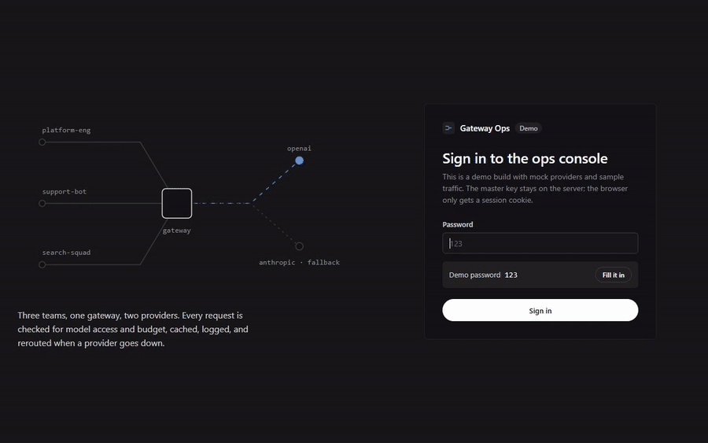
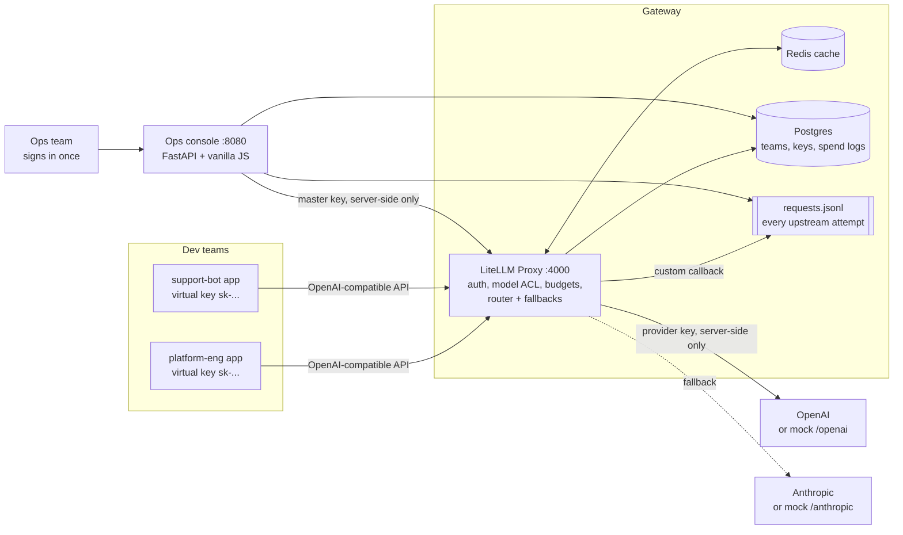
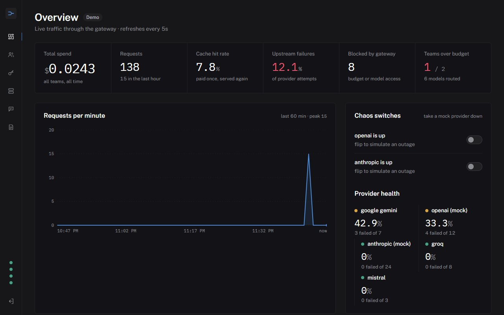
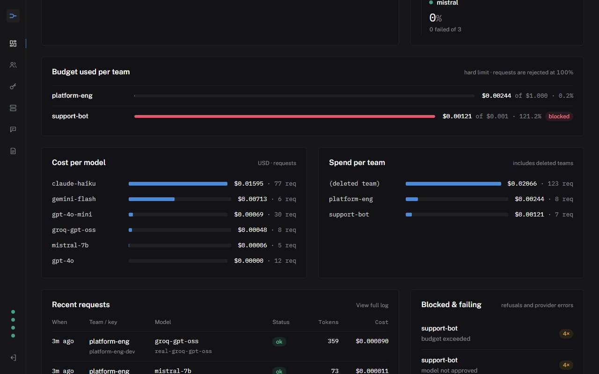
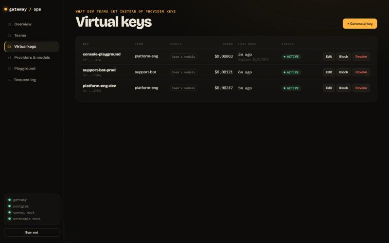
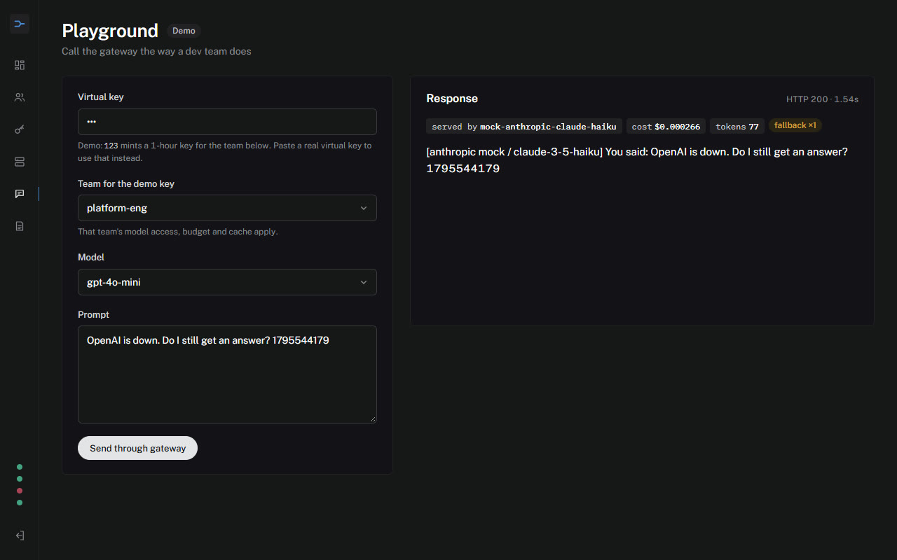
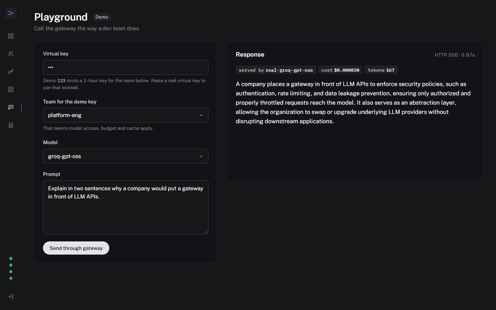

# LLM Gateway demo (LiteLLM Proxy)

A small, runnable reconstruction of an LLM gateway I built for a paying client.

> **Honest note.** This is not the client's code, and it contains none of their
> config, data or keys. The client code is private. This repo rebuilds the same
> ideas from scratch on a smaller scale, so recruiters and clients can run it and
> see how it works. Provider calls go to a local mock by default, so the whole
> demo runs offline with no paid API keys.



## What it shows

| Problem the ops team had | What the gateway does | Where |
|---|---|---|
| Raw provider keys were shared with every dev team | Ops issues one **virtual key per team**. Each key can call only that team's approved models. Devs never see provider keys. | LiteLLM teams + keys, `scripts/demo.py` step 1-2 |
| Same prompts were paid for again and again | **Response cache** (Redis in Docker, in-memory locally) | `litellm_settings.cache` |
| Nobody knew which team spent what | **Spend tracking per team, key and model**, with **hard budgets**. Requests are rejected once a team's budget is used. | LiteLLM spend tables, demo step 5 |
| No audit trail | **Request logging**: LiteLLM spend logs (metadata only by default) plus a custom callback that also records failed provider attempts | `gateway/request_logger.py` |
| One provider outage took features down | **Automatic fallback**: `gpt-4o*` falls back to `claude-haiku` | `router_settings.fallbacks`, demo step 4 |
| Ops had no single view, and every change was a config edit | **Ops console** (web app): live overview (spend per team and model, budget meters, provider health, outage switches) plus self-service teams, virtual keys, encrypted provider keys, model routes and a playground | `console/` |

## Architecture



Components:

- **`gateway/`**: LiteLLM proxy config (`config.yaml` for Docker with Redis, `config.local.yaml` for the no-Docker run with an in-memory cache) and `request_logger.py`, a LiteLLM `CustomLogger` that writes one prompt-free JSON line per upstream attempt (success or failure).
- **`mock_provider/`**: a tiny OpenAI-compatible FastAPI server that pretends to be two providers (`/openai/v1`, `/anthropic/v1`). `POST /admin/failures {"openai": true}` makes one provider return HTTP 503: that is the "force failure" switch for showing fallback.
- **`console/`**: the ops console. `server.py` is a small FastAPI backend; `static/` is a no-build vanilla JS frontend. Ops sign in once with the master key. The server checks it, sets an HttpOnly, SameSite=Strict session cookie, and makes every LiteLLM admin call itself, so the browser never holds the master key. Pages:
  - **Overview**: total spend, requests per minute, budget meters per team, cost per model and team, provider health, recent requests, blocked and failing calls. Also has "chaos switches" that take a mock provider down to show fallback live.
  - **Teams**: create a team, approve its models, set or change its budget, block, delete.
  - **Virtual keys**: generate a key (team, optional model limits, budget, expiry). The full key is shown once and never stored by the console. Edit, block, unblock, revoke.
  - **Providers & models**: store a provider API key. It goes to LiteLLM's credential store, encrypted with `LITELLM_SALT_KEY`, and is never sent back. Add or remove model routes that use a stored key. Models defined in the config file are shown read-only.
  - **Playground**: call any model with a virtual key, exactly as a dev team would. Shows which deployment answered, the cost, cache hits and fallbacks.
  - **Request log**: every upstream attempt and gateway refusal, filterable. Prompts are never logged.

  Data shaping lives in `console/metrics.py` and is unit tested.
- **`scripts/demo.py`**: the scripted story (teams, keys, model denial, cache, fallback, budget block).
- **`scripts/run_local.py`**: runs everything without Docker, with an embedded Postgres (`pgserver`).

LiteLLM's built-in admin UI also works at `http://localhost:4000/ui` (user `admin`, password = the master key). The custom console exists because the per-provider failure view and the one-page ops summary were what the client actually wanted, and some of LiteLLM's richer spend reports are Enterprise-only.

## Run it

### Option A: Docker (proxy + Postgres + Redis + mock + console)

Status: written but **not yet run end to end** (the machine this was built on has no
Docker). Option B below is the tested path.

```bash
cp .env.example .env        # demo values: console password is 123
docker compose up -d
python scripts/demo.py      # needs: pip install httpx python-dotenv
```

### Option B: no Docker (Windows, macOS, Linux), 4 commands

Needs Python 3.11 and [uv](https://docs.astral.sh/uv/) (or plain `pip`).

```bash
git clone https://github.com/frragh4vv/llm-gateway-demo && cd llm-gateway-demo
uv venv --python 3.11 .venv && uv pip install --python .venv --require-hashes -r requirements.lock
.venv/Scripts/python scripts/run_local.py      # macOS/Linux: .venv/bin/python
.venv/Scripts/python scripts/demo.py           # in a second terminal
```

`run_local.py` creates `.env` with demo values (password `123`) on first run, starts an embedded
Postgres in `.data/pg`, the mock provider, the LiteLLM proxy and the ops console, and
writes each process's output to `logs/*.log`. The first start takes a few minutes:
it runs `prisma generate` against LiteLLM's schema (the Docker image does this at
build time), Prisma downloads its engines, and LiteLLM migrates the database.

URLs: ops console `http://localhost:8080` (sign in with password `123`), gateway `http://localhost:4000`,
LiteLLM UI `http://localhost:4000/ui`, mock provider `http://localhost:8001/health`.

### Using real providers (free tier)

The config also has three real, free-tier models. Their keys are read from `.env` only:

| Model name | Provider model | Key |
|---|---|---|
| `gemini-flash` | `gemini/gemini-2.5-flash` | `GEMINI_API_KEY` |
| `groq-gpt-oss` | `groq/openai/gpt-oss-20b` | `GROQ_API_KEY` |
| `mistral-7b` | `mistral/open-mistral-7b` | `MISTRAL_API_KEY` |
| `gemini-retired` | a deliberately dead Gemini model ID, so it always fails | `GEMINI_API_KEY` |

The fallback chain is `gemini-flash` then `groq-gpt-oss` then `mistral-7b`. `gemini-retired` falls back to Groq. This is the real-world case the gateway is for. While this demo was being built, Groq retired `llama-3.3-70b-versatile`, and the gateway silently served those calls from Mistral instead.

Set the keys in `.env`, restart, and run `python scripts/demo.py --real`. Dev teams still get only virtual keys. To use OpenAI or Anthropic, uncomment the paid models in `gateway/config*.yaml`.

## Demo output

Real output from `python scripts/demo.py --real` against the local stack. Keys are masked by the script. Steps 6-7 called real Gemini, Groq and Mistral free-tier APIs:

```text
Waiting for gateway...

1) Ops creates teams and virtual keys
  removed 2 team(s) from a previous run
  team platform-eng  models=['gpt-4o-mini', 'gpt-4o', 'claude-haiku', 'gemini-flash', 'groq-gpt-oss', 'mistral-7b', 'gemini-retired'] budget=$1.0 key=sk-eUV...kmpA
  team support-bot   models=['claude-haiku'] budget=$0.001 key=sk-ETM...ENzw

2) Model access: support-bot asks for gpt-4o (not approved)
  -> HTTP 403 (denied as expected)

3) Caching: platform-eng sends the same prompt twice
  first 0.63s, second 0.12s (x5.2 faster, served from cache)

4) Fallback: OpenAI goes down, platform-eng keeps calling gpt-4o-mini
  -> HTTP 200, answered by: anthropic mock / claude-3-5-haiku

5) Budget: support-bot sends traffic until its $0.001 budget runs out
  request 1: ok
  request 2: ok
  request 3: ok
  request 4: ok
  request 5: ok
  request 6: HTTP 422 budget exceeded -> blocked

6) Real providers through the same virtual key (free-tier keys live only on the gateway)
  gemini-flash  -> served by real-gemini-flash in 7.3s, cost $0.001997
                   "An LLM gateway centralizes control over cost, security, observability, and provider routing to ensure efficient, compliant, and scalable use"
  groq-gpt-oss  -> served by real-groq-gpt-oss in 1.0s, cost $0.000029
                   "To give a single, secure, policy‑aware entry point that abstracts provider quirks, enforces rate limits and usage quotas, and enables cachin"
  mistral-7b    -> served by real-mistral-7b in 1.4s, cost $0.000011
                   "An **LLM gateway** sits in front of provider APIs to **unify, optimize, and secure interactions**—aggregating multiple models, managing rate"

7) Real fallback: call gemini-retired, a dead Gemini model ID
  Gemini returned an error -> answered by real-groq-gpt-oss

Done. Open the ops console to see spend, budgets, failures and recent requests.

Summary: all scenarios passed
```

The budget block comes back as HTTP 422 with `Budget has been exceeded!` in LiteLLM 1.108.13.

## Screenshots







## Tests

```bash
.venv/Scripts/python -m pytest
```

Covers the demo script's whole story against a fake gateway (`httpx.MockTransport`),
the mock provider's failure switch, the request logger's record shape (and that
prompts never reach the log), the console (login, CSRF header, provider keys never
returned, the one-time key reveal, metrics), and config sanity checks
(no secrets in config, fallback targets exist, Docker and local configs match,
litellm pinned to the reviewed version).

## Why litellm 1.108.13 (dependency security)

LiteLLM had two PyPI supply-chain compromises and a run of proxy CVEs in 2026, so
the version is chosen on purpose and pinned exactly, with hashes.

Checked on 2026-11-24 against all 30 published advisories in the GitHub security tab:

- **Malicious releases, never install:** `1.82.7` and `1.82.8` (March 24, 2026,
  TeamPCP; a `litellm_init.pth` file ran on every Python start) and `1.107.0`
  (October 21, 2026; credential-stealing code pushed through LiteLLM's own release
  pipeline to PyPI and to the Docker tags `v1.107.0`, `latest`, `main-latest`,
  `main-stable`). This is why the compose file never uses `:latest`.
- **Why it moved from 1.106.5:** November advisories reached that version. The one that
  matters most here is GHSA-4xm2-x5g5-wc8q (fixed 1.108.13): virtual keys with no
  assigned user could read other such keys' metadata, and this demo issues exactly that
  kind of key. Also fixed on the way: GHSA-2rwg-2wh4-7c4f (1.108.6, Azure only) and
  GHSA-wpm4-hgr2-xjwr, GHSA-2364-6whj-g7vx and GHSA-fjxr-j47c-4x2x (1.108.0).
- **Still open on 1.108.x:** GHSA-w5h5-479w-p5hx (JWT/SSO email fallback, fixed only in
  1.111.0, which had no stable release yet). This demo uses neither JWT nor SSO sign-in.
- **What was verified locally:** the Windows wheel's SHA-256 matches PyPI; it contains no
  `.pth` startup file; a scan of every file found no known incident indicators (the only
  string hits were guardrail test prompts inside LiteLLM's own admin UI). After install,
  the only `.pth` files in the venv are pywin32's and virtualenv's. All demo steps,
  including `--real`, were re-run on this version.
- **Limits, stated plainly:** LiteLLM's own post-incident write-up says signatures and
  provenance do not prove a release is clean. Nothing had been reported against 1.108.13
  as a malicious release on that date, but re-check the
  [LiteLLM security tab](https://github.com/BerriAI/litellm/security) before
  upgrading or deploying.

How it is pinned:

- `requirements.lock`: every package pinned with hashes (`uv pip compile --generate-hashes`), installed with `--require-hashes`.
- `docker-compose.yml`: `ghcr.io/berriai/litellm:v1.108.13@sha256:65a9631f...`, plus Postgres, Redis and Python base images pinned by digest.
- `LITELLM_LOCAL_MODEL_COST_MAP=True`: the proxy uses its bundled price map instead of fetching one from GitHub at startup.

Sources: [LiteLLM March incident](https://docs.litellm.ai/blog/security-update-march-2026),
[October attack chain](https://docs.litellm.ai/blog/security-incident-oct-21-2026-attack-chain),
[Help Net Security on 1.107.0](https://www.helpnetsecurity.com/2026/10/22/litellm-compromised-supply-chain-attack-pypi-docker/),
[CVE-2026-42208](https://docs.litellm.ai/blog/cve-2026-42208-litellm-proxy-sql-injection),
[GitLab advisory GHSA-7hp6-4w63-5g45](https://advisories.gitlab.com/pypi/litellm/CVE-2026-114612/).

## Secrets

- `.env` is git-ignored; `.env.example` holds placeholders only.
- The master key and salt key exist only in `.env` / the environment. Configs reference them as `os.environ/...`; a test fails if a literal key appears in a config.
- Ports are bound to `127.0.0.1` in Docker.
- The demo prints virtual keys masked (`sk-abc...wxyz`).
- Prompts are not stored: `store_prompts_in_spend_logs: false`, and the custom logger writes metadata only.

## License

[ISC](LICENSE)
